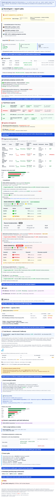

# 📈 StockAgent
**Designed and maintained by [Dominik](https://www.linkedin.com/in/dominik-sienkiewicz/), built with AI coding agents:** I set the architecture, write the specifications, define the quality gates enforced in CI and review every change.

**Educational proof of concept — not investment advice.** A Python and LangGraph agent that
analyses a fixed watchlist of US stocks, ETFs and crypto. It combines price action with
curated financial news sentiment, cross-checks the LLM's reading against Alpha Vantage data,
scores every past prediction against the realised price, and writes a Polish-language report
email with charts and its own running hit-rate.

## Engineering evidence (10-minute tour)

Each claim links the file that backs it, and each of those runs in CI.

- **The domain is plain Python.** → [`tests/test_architecture.py`](tests/test_architecture.py)
  → parses every import (local and `TYPE_CHECKING` ones included) and fails when the domain
  reaches beyond the standard library or the application reaches into the infrastructure.
- **The schema is tested on a real Postgres with pgvector, not on mocks.** →
  [`tests/infrastructure/test_migrations.py`](tests/infrastructure/test_migrations.py) →
  applies every migration in a container, including the regression where `013` met
  duplicate rows from before idempotency and must deduplicate before its unique index.
- **A model ships only if it beats naive baselines out of sample.** →
  [`src/infrastructure/adapters/xgboost_local.py`](src/infrastructure/adapters/xgboost_local.py)
  → expanding-window walk-forward folds against the no-change, mean-drift and LLM-only
  baselines, a 2% margin and a paired loss test; so far it has shipped nothing, and the
  report says so. Passing is necessary, not sufficient: it keeps out a model worse than a
  free rule, it does not prove skill.
- **Every external source is a port with a safe fallback.** →
  [`src/application/ports.py`](src/application/ports.py) (`InsiderFlowPort`) →
  [`src/infrastructure/adapters/edgar_insider.py`](src/infrastructure/adapters/edgar_insider.py)
  (EDGAR adapter and `NullInsiderFlowAdapter`) → the composition root picks one, and the
  graph never knows which.
- **Untrusted text cannot break the email or leak from the public page.** →
  [`tests/application/test_report_builder.py`](tests/application/test_report_builder.py)
  escapes LLM, news and error text and rejects non-http(s) links;
  [`tests/application/test_report_public_scorecard.py`](tests/application/test_report_public_scorecard.py)
  feeds the public scorecard a symbol, an email address and prices, and asserts none of them
  reaches the page.
- **The docs cannot point at nothing.** → [`tests/test_markdown_links.py`](tests/test_markdown_links.py)
  → every relative link in tracked Markdown must resolve, in the same pytest gate that runs
  locally and in CI.

## Status

**The daily report run is paused** since 2026-08-17, when commit `02fc397` commented out
its cron; it starts only on manual `workflow_dispatch`. The reason is decision 2: the loop's
cost and its silent failures. Every weekday run paid for LLM, council and Alpha Vantage
calls, and a run that failed or did not start raised no alarm. Waves A to R have since added
a ceiling on the paid calls of a cycle, an explicit weekly budget, a daily deadman, an
external heartbeat and explicit write and paid-call switches in the workflows. The hourly
price-shock check is paused too (`f886da0`), but it can resume on its own: it reads each
symbol's change for the day from the same free quote and uses the daily run's snapshots
only as a fallback. Two jobs still run on schedule: the weekly model retraining, and a free
daily deadman that mails when a job that should run has gone quiet. The retraining has not
shipped weights yet. Its last run (2026-10-11) still trained one model per symbol and
skipped all 45: the best-covered symbol had 17 settled predictions against the 50 required,
288 across all symbols. Training now fits one shared
model on the pooled predictions of every symbol, so the 50-sample minimum applies to that
pooled sample, and weights ship only if the shared candidate also passes the walk-forward
gate against the strongest of three baselines: no change, the mean drift and the LLM
direction alone. Until a run ships them, the XGBoost leg runs on the no-change baseline
and the report and the council prompt label it as cold-start.

**Resume.** The conditions and the owner's steps, in order, are in the
[resume checklist](docs/resume-checklist.md): the secret Supabase key, the pending
migrations and the flags they unlock, the heartbeat secret, the experiment windows, the
deadman's gap for the daily run, and uncommenting the crons last. Once the daily run's cron
is active, `tests/test_workflow_env_wiring.py` fails unless a deadman runs on a cron and the
cost ceiling, the weekly budget, the liveness gap and the write and paid-call switches are in
place. Every run, scheduled or manual, is listed on the
[GitHub Actions workflows page](https://github.com/DominikSienkiewicz/StockAgent/actions).

**Database risk: the Supabase Free plan.** The Supabase project is on the Free plan, which
pauses a project after 7 days without activity. While the daily run and the shock check are
paused, the only job that writes to the database is the weekly retraining, so one late
GitHub cron run can be enough for a pause; until the project is restored in the Supabase
dashboard, every job fails on connect. The daily deadman therefore starts each run with a
read-only query of one `price_snapshots` row through PostgREST, with no paid keys, and mails
when the database does not answer. It is a monitor, not a keepalive: it reports a pause that
has already happened, and it does not guarantee that Supabase will not pause the project.

## Who this is for

For now StockAgent is a portfolio project that has to carry live, verifiable evidence, not a
subscription product, and that decides the order of work: docs that claim only what the code
does; public proof (the public scorecard and the commit-reveal log of predictions); a demo
that renders without any key and the reviewer's tour above; and only then subscriptions, with
the GDPR and terms-of-service work they need. The public hit rate may turn out weak. It gets
published anyway: a weak result anyone can check says more than a strong one nobody can.

## 🧠 The Vision: Signal over Noise

In the era of AI-driven information overload, a single price tick is a useless signal — what
matters is the **covariance of sentiment, news, and historical predictions**. This agent
treats the market as a system: it pulls clean numerical data, enriches it through a curated
financial filter, is built to model hybridly (LLM for reasoning + XGBoost for quantitative
inference, once XGBoost has earned its weights against a naive baseline),
and **cyclically confronts itself with reality** through Self-Reflection. It's not a scraper,
and it's not another "GPT predict stocks" — every prediction it makes is recorded, closed
against the realised price, and fed back into the next run.

## One pass, end to end

`price` → `self-reflection on the last prediction` → `cached fundamentals` →
**volatility gate** → `sentiment + news` → `LLM cross-validation` → `local XGBoost (baseline until trained)` →
`7-persona advisory council` → `persist + RAG + price snapshot` → `HTML email`. Below the gate a symbol
ends in `ignore` (price snapshot only), and past it, once the cycle's paid-call ceiling is spent, in
`budget_exhausted` (no snapshot). The diagram in [how it works](docs/how-it-works.md#how-it-works) is
generated from the graph's code, and a test fails when the two drift apart.

The gate is the point: below the threshold no paid API is touched at all. A cycle where
every symbol was filtered reports **zero paid calls**, and the report prints that bill.

## What lands in the inbox

One email per cycle, in Polish: the moves that matter first, then every past prediction
scored against the realised price, the ranked signals, a block per analysed symbol (LLM reading,
model forecast, advisory council, data-provenance badges, an 80% interval), and a back office
with risk, the track record, the model scorecard and the cycle's bill. The sample below is
rendered from fictional data, with English labels added for this screenshot; section by
section it is described in [the report email](docs/report-email.md).

Annotated sample email (fictional data, rendered 2026-10-20)

The same sample as HTML is [docs/img/report-email.html](docs/img/report-email.html) (GitHub
shows its source; open it locally in a browser). Render it yourself without any key, database
or network: `uv run python main_tools.py render-sample-report` writes the HTML and the
plain-text version to `build/sample-report/`. The screenshot is not regenerated
automatically, so it can lag behind the email after a report change.

## Documentation

| Document | What's in it |
|---|---|
| [How it works](docs/how-it-works.md) | The eleven pipeline steps, every data source, the symbol and crypto pools, quota monitoring, Risk Watch, and the risk / trade signals |
| [The report email](docs/report-email.md) | Section-by-section anatomy of what lands in the inbox |
| [Running it](docs/running-locally.md) | Stack, prerequisites, local setup, database migrations, build commands, GitHub Actions, secret management |
| [Configuration](docs/configuration.md) | Every `Settings` field with its default, plus the feature flags and what each one costs |
| [Data and access](docs/data-and-access.md) | Every table and view with its data class and who reads and writes it, the Supabase keys, retention, and the Row Level Security rollout |
| [Reference signal protocol](docs/reference-protocol-v1.md) | The frozen rule of the free weekly benchmark the paid LLM has to beat (`reference-v1`) |

Architecture: **Hexagonal (Ports & Adapters) + DDD**. Domain (pure Python, zero deps) →
Application (ports + use cases + LangGraph) → Infrastructure (adapters for API / DB / LLM /
ML / email). The dependency arrow flows one way, and
[`tests/test_architecture.py`](tests/test_architecture.py) fails when it does not: a domain
module that imports anything beyond the standard library and `src.domain`, an application
module that imports the infrastructure or an entry point, or `typing.Any` in the domain
outside `attestation.py`.

## Pre-registered parameters

The values that decide when the agent predicts and how a prediction is scored were fixed in
the repository before the track record that judges them. Each row names the commit that set
the value. The `config.toml` values are part of `config_hash`, so changing one starts a new
`recipe_version` segment instead of passing for a change in accuracy; the domain constants
change only through a commit to the file named.

| Parameter | Value | Where | Commit | Date |
|---|---|---|---|---|
| Volatility gate, stocks and ETFs (`volatility_threshold`) | `0.02` | `config.toml` | `3e4a37f` | 2026-05-13 |
| Council gate (`council_volatility_threshold`) | `0.03` | `config.toml` | `4014008` | 2026-05-19 |
| Volatility gate, crypto (`crypto_volatility_threshold`) | `0.05` | `config.toml` | `c51954a` | 2026-06-01 |
| Minimum age before a prediction is scored (`reflection_min_age_hours`) | 6 h | `config.toml` | `48378c4` | 2026-06-05 |
| Hit rate that counts as good in position sizing (`GOOD_HIT_RATE_THRESHOLD`) | `0.55` | `src/domain/sizing.py` | `3e6a493` | 2026-06-21 |
| SIDEWAYS band, stocks and ETFs (`SIDEWAYS_TOLERANCE`) | ±0.5% | `src/domain/prediction.py` | `3e4a37f` | 2026-05-13 |
| SIDEWAYS band, crypto (`CRYPTO_SIDEWAYS_TOLERANCE`) | ±2.5% | `src/domain/prediction.py` | `4785eab` | 2026-07-10 |

The scoring rules themselves are machine-readable in
[`evaluation_protocol.toml`](evaluation_protocol.toml): the horizon, the hit rule with its
SIDEWAYS bands and directional dead zone, the baselines, the primary metrics, α, the window,
the adoption date and how the universe was selected. Its sha256 is part of every prediction's
recipe and of every attestation commitment, and the public scorecard prints it, so a metric
cannot be chosen after the results are in; a test fails when the file and the domain constants
disagree. A new protocol is a new version with its own hash, and results scored under the old
one stay in their own segment.

**No retroactive LLM replays.** The LLM is never backtested on history: it has read the news
and prices of the days it would be "predicting", so a replay measures memory, not forecasting,
and every replayed day costs paid calls. `main_backtest.py` replays only the stored feature
rows through XGBoost walk-forward folds, and
`tests/test_main_entrypoints.py::TestMainBacktest::test_backtest_builds_no_paid_adapter` fails
if it ever builds an OpenAI, Anthropic or Alpha Vantage client. The LLM's record is the live
one: predictions written before the outcome and scored once it is known.

## What this does NOT prove (known limitations)

The rule: a claim in this README links the code or the test behind it, and the limit of a
claim is written next to the code, where a change has to face it.

1. **Attestation is tamper-evidence, not a timestamp.** The docstring of
   [`src/domain/attestation.py`](src/domain/attestation.py) says so: Git commit dates can be
   forged, so commit-reveal only shows that a published commitment was not altered later
   under branch protection. Today nothing is published: `attestation_enabled` stays off until
   a workflow has a publish step.
2. **The model scorecard describes the candidate, not the shipped model.** `METRIC_NOTE` in
   [`src/domain/model_scorecard.py`](src/domain/model_scorecard.py), printed under every
   scorecard: the metrics come from walk-forward folds, while the shipped model is refit on
   all data and not validated again.
3. **The cycle cost is an estimate.** [`src/application/report_finops.py`](src/application/report_finops.py)
   marks every amount not priced from tokens as an estimate and ends the section with a note
   that it is not an invoice; [configuration](docs/configuration.md) lists the requests the
   meter does not see.
4. **No trained weights yet.** The XGBoost leg runs on the no-change baseline, and the report
   and the council prompt label it as cold-start (see [Status](#status)).
5. **Nothing is public yet, and the daily run is paused.** The public scorecard and the
   attestation log are implemented and unit-tested but not deployed (see the
   [resume checklist](docs/resume-checklist.md)), and with the daily run paused since
   2026-08-17 no live track record is accumulating.
6. **A short track record is an anecdote.** Telling a 55% hit rate from a coin flip with a
   one-sided test (α = 0.05, 80% power) takes about 617 settled directional predictions in
   `n_eff` (`required_n` in [`src/domain/significance.py`](src/domain/significance.py)). The
   public scorecard prints that number, the window's `n_eff` and, at the window's pace, the
   date the sample would suffice; while the daily run is paused there is no inflow and no date.

Each channel carries its own honesty note:

| Channel | Honesty note it carries |
|---|---|
| Report email, every cycle | The investment disclaimer in the footer, the cost as an estimate, `METRIC_NOTE` under the model scorecard, and a cold-start label while there are no weights |
| Public scorecard (not deployed yet) | A methodology section, the naive "always BULLISH" baseline next to the hit rate, and no symbols, addresses or amounts (an anti-PII test) |
| Attestation log (not published yet) | Tamper-evidence under branch protection, not a timestamp; canonicalisation frozen by golden tests |
| GitHub Actions run summary (public) | Aggregates only: no symbol, address, error text, price or position |

## Disclaimer

Educational / proof-of-concept project demonstrating expertise in Agentic AI, Hexagonal
Architecture, and FinOps. **Generated predictions do not constitute investment advice.**
Make financial decisions at your own risk, after consulting a licensed advisor.

**Survivorship bias.** The watchlist was hand-picked (2026-06) with knowledge of how those
companies had already risen, so a long bias on it is not skill. The track record and the
public scorecard show the naive "always BULLISH" baseline on the same predictions for that
reason, and each prediction's recipe records a `universe_version` (a hash of the sorted
watchlist), so adding symbols starts a new segment instead of passing for better accuracy.
Their paper-PnL equity curve is net of trading costs charged on turnover (10 bps, crypto
25 bps) and sits next to two buy&hold benchmarks with the same costs: a basket of the same
symbols in the same windows and IVV, together with a market-relative hit rate (did the
direction get the sign of the return over IVV right).

## License

[MIT](LICENSE)
