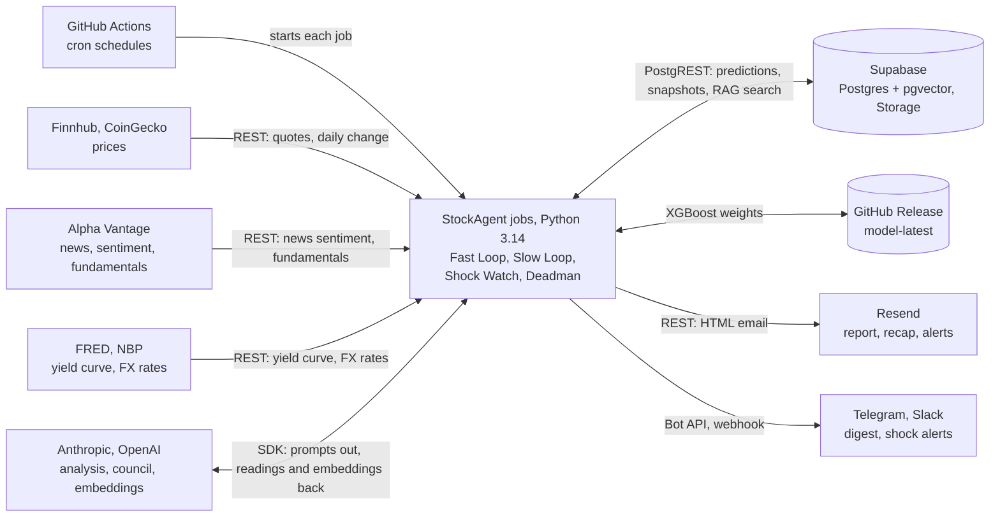
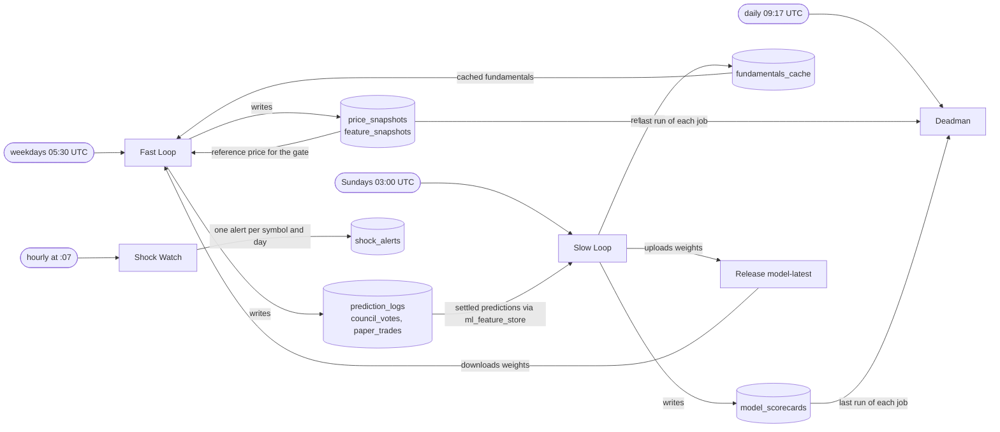
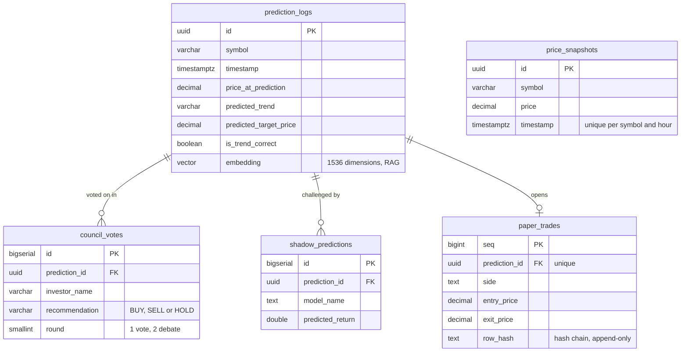
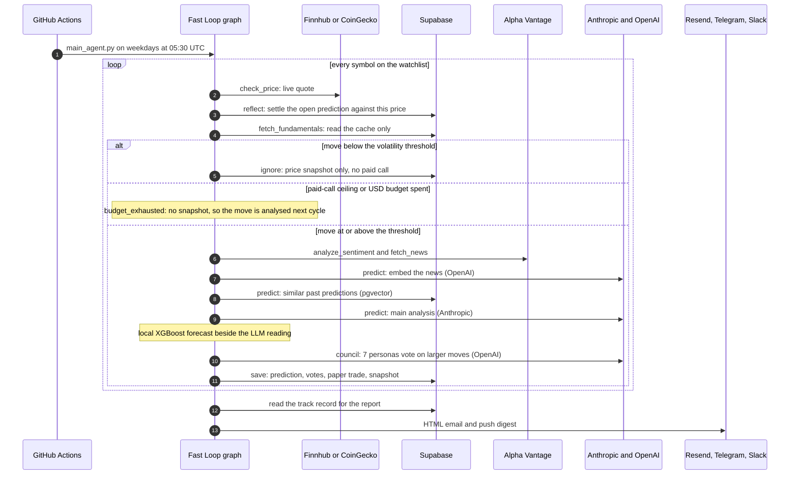
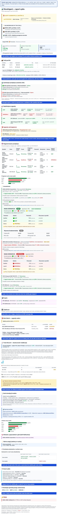
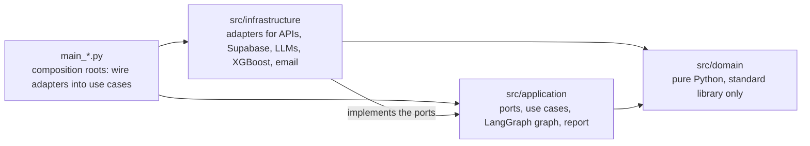

# 📈 StockAgent

**Designed and maintained by [Dominik Sienkiewicz](https://www.linkedin.com/in/dominik-sienkiewicz/), built with AI coding agents:** I set the architecture, write the specifications and define the quality gates CI runs on every push to `main` and every pull request: ruff, mypy --strict and pytest, including schema tests on a real Postgres with pgvector ([Testing](#testing)).

**Educational proof of concept — not investment advice.** A Python and LangGraph agent that
analyses a fixed watchlist of US stocks, ETFs and crypto. It combines price action with
curated financial news sentiment, cross-checks the LLM's reading against Alpha Vantage data,
scores every past prediction against the realised price, and writes a Polish-language report
email with charts and its own running hit-rate. Its quota-alert banner shows only alerts from the run
that generated the report; earlier events remain in the database for diagnostics.


[](tests/test_architecture.py)

[](https://github.com/DominikSienkiewicz/StockAgent/actions/workflows/ci.yml)
[](https://sonarcloud.io/dashboard?id=DominikSienkiewicz_StockAgent)
[](https://sonarcloud.io/dashboard?id=DominikSienkiewicz_StockAgent)

## Engineering evidence (10-minute tour)

Each claim links the file that backs it, and each of those runs in CI.

- **The domain is plain Python.** → [`tests/test_architecture.py`](tests/test_architecture.py)
  → parses every import (local and `TYPE_CHECKING` ones included) and fails when the domain
  reaches beyond the standard library or the application reaches into the infrastructure.
- **The schema is tested on a real Postgres with pgvector, not on mocks.** →
  [`tests/infrastructure/test_migrations.py`](tests/infrastructure/test_migrations.py) →
  applies every migration in a container, including the regression where `013` met
  duplicate rows from before idempotency and must deduplicate before its unique index.
- **A model ships only if it beats naive baselines out of sample.** →
  [`src/infrastructure/adapters/xgboost_local.py`](src/infrastructure/adapters/xgboost_local.py)
  → expanding-window walk-forward folds against the no-change, mean-drift and LLM-only
  baselines, a 2% margin and a paired loss test; so far it has shipped nothing, and the
  report says so. Passing is necessary, not sufficient: it keeps out a model worse than a
  free rule, it does not prove skill.
- **Every external source is a port with a safe fallback.** →
  [`src/application/ports.py`](src/application/ports.py) (`InsiderFlowPort`) →
  [`src/infrastructure/adapters/edgar_insider.py`](src/infrastructure/adapters/edgar_insider.py)
  (EDGAR adapter and `NullInsiderFlowAdapter`) → the composition root picks one, and the
  graph never knows which.
- **Untrusted text cannot break the email or leak from the public page.** →
  [`tests/application/test_report_builder.py`](tests/application/test_report_builder.py)
  escapes LLM, news and error text and rejects non-http(s) links;
  [`tests/application/test_report_public_scorecard.py`](tests/application/test_report_public_scorecard.py)
  feeds the public scorecard a symbol, an email address and prices, and asserts none of them
  reaches the page.
- **The docs cannot point at nothing.** → [`tests/test_markdown_links.py`](tests/test_markdown_links.py)
  → every relative link in tracked Markdown must resolve, in the same pytest gate that runs
  locally and in CI.
- **Every `fix:` commit carries its regression test.** →
  [`src/tools/commit_policy.py`](src/tools/commit_policy.py) → `uv run python main_tools.py
  commit-policy` checks the branch before `scripts/merge.sh`; the rule applies from 2026-10-26
  and older history is not rewritten.

## Invariants under test

The rules that keep the loop cheap and a bad day survivable, each with the test that fails when it breaks; [how it works](docs/how-it-works.md#invariants-and-the-tests-behind-them) says why each one matters. A test checks that every named test still exists.

| Invariant | Enforced by |
|---|---|
| The volatility gate never loosens: the regime, earnings and drift multipliers can only raise the threshold | [`tests/domain/test_asset.py`](tests/domain/test_asset.py) `TestEffectiveThreshold::test_a_multiplier_below_one_never_loosens_the_gate`; [`tests/domain/test_earnings.py`](tests/domain/test_earnings.py) `test_threshold_multiplier_never_loosens_gate` |
| A symbol below the gate costs nothing: no sentiment, news, prediction or paid diagnosis, and a fully gated cycle says so in the email | [`tests/application/test_analyze_market_use_case.py`](tests/application/test_analyze_market_use_case.py) `TestRun::test_ignores_minor_change_below_threshold`; [`tests/application/test_agent_graph.py`](tests/application/test_agent_graph.py) `TestReflectMistakeDiagnosisGatedByVolatility::test_skips_paid_diagnosis_when_below_threshold_but_still_records`; [`tests/application/test_report_finops.py`](tests/application/test_report_finops.py) `test_free_cycle_renders_explicitly_html` |
| A symbol cut by the cycle's paid-call ceiling, or by a spent daily or monthly LLM budget, ends without an analysis and without a price snapshot | [`tests/application/test_agent_graph.py`](tests/application/test_agent_graph.py) `TestPaidCallBudget::test_third_symbol_routed_to_ignore_with_budget_exhausted_flag`, `TestLedgerBudgetSpent::test_symbol_past_the_gate_pays_nothing_and_keeps_its_reference` |
| The threshold is validated: `Settings` refuses a volatility threshold of 0 | [`tests/test_config.py`](tests/test_config.py) `test_zero_volatility_threshold_rejected` |
| One failing symbol never fails the cycle; the Fast Loop exits 1 only when every symbol failed | [`tests/test_main_agent.py`](tests/test_main_agent.py) `TestMainAgent::test_main_returns_zero_on_partial_failure`, `TestMainAgent::test_main_returns_one_when_all_symbols_fail`, `TestAnalyzeSymbolsParallel::test_parallel_single_failure_isolated` |
| Writes are idempotent: predictions and price snapshots are upserts on `(symbol, timestamp_hour)`, and only a terminal node writes the snapshot | [`tests/infrastructure/test_supabase_repository.py`](tests/infrastructure/test_supabase_repository.py) `TestSavePrediction::test_upsert_uses_symbol_timestamp_hour_conflict_key`, `TestSavePriceSnapshot::test_upsert_uses_symbol_timestamp_hour_conflict_key`; [`tests/application/test_agent_graph.py`](tests/application/test_agent_graph.py) `TestPriceSnapshot::test_snapshot_not_written_when_cycle_crashes_before_terminal` |
| `main_watch.py` and `main_deadman.py` build no paid port, and the watch writes no price snapshot | [`tests/test_main_watch.py`](tests/test_main_watch.py) `test_watch_starts_with_stubbed_paid_ports_and_database_writes`, `TestWatchCycle::test_watch_never_writes_a_price_snapshot`; [`tests/test_main_deadman.py`](tests/test_main_deadman.py) `test_deadman_builds_no_paid_adapter` |
| The owner's Telegram bot answers only the `TELEGRAM_CHAT_ID` chat, and a symbol muted from it skips the paid analysis but keeps its price snapshot | [`tests/infrastructure/test_telegram_command_source.py`](tests/infrastructure/test_telegram_command_source.py) `test_only_owner_text_messages_pass_and_offset_moves_past_every_update`; [`tests/test_main_agent_mutes.py`](tests/test_main_agent_mutes.py) `TestFastLoopMutes::test_muted_symbol_skips_the_graph_but_keeps_its_price_snapshot` |
| CI is under test: the quality job runs ruff and mypy on every entry point, and an active Fast Loop cron needs the deadman, the cost ceiling and the weekly budget | [`tests/test_quality_gate_sync.py`](tests/test_quality_gate_sync.py) `test_ci_quality_job_runs_ruff_and_mypy`, `test_ci_lints_and_typechecks_every_entrypoint`; [`tests/test_workflow_env_wiring.py`](tests/test_workflow_env_wiring.py) `test_enabled_fast_loop_schedule_requires_deadman` |

## Testing

The quality job of [CI](.github/workflows/ci.yml) runs these commands on every push to `main`
and every pull request, and they are the local gate too.
[`tests/test_quality_gate_sync.py`](tests/test_quality_gate_sync.py) fails when this block,
[AGENTS.md](AGENTS.md) or the [running guide](docs/running-locally.md) quotes a command CI
does not run:

```bash
uv run ruff check .
uv run ruff format --check .
uv run mypy          # strict: src, every main_*.py and all of tests/
uv run pytest -m "not integration and not containers"
```

Two markers split off what the plain run leaves out. `integration` marks tests against the
live APIs (paid LLM calls, a real email): they skip without keys, the CI gate never runs
them, and only the manual Integration smoke workflow does, with its own keys. `containers`
marks the tests that need Docker: CI runs them as a separate step and fails when no Docker
daemon answers. On top of the plain run, CI measures the branch coverage of `src/domain`
against a floor that only rises. CI also lints the workflows and shell scripts (actionlint,
zizmor, shellcheck) and scans `uv.lock` with osv-scanner on lockfile changes and weekly.

The layers are tested where they live:

- **Domain:** plain Python without mocks, so a rule is checked on values in and decisions out.
- **Adapters:** `requests.Session` mocked, parsers fed payloads in the shape of real provider
  answers ([`tests/fixtures/providers/`](tests/fixtures/providers/)), and no socket: a unit
  test that tries the network fails ([`tests/test_network_isolation.py`](tests/test_network_isolation.py)).
- **Application:** the graph, the use cases and the report run on `Mock(spec=Port)` fakes
  and an in-memory repository.
- **Schema and repository:** every migration applied to a real Postgres with pgvector, and
  the repository's contract checked against a real PostgREST, both in containers.

Setup, the local run and the build commands are in [running it](docs/running-locally.md).

Alpha Vantage keys go in the secret `ALPHA_VANTAGE_API_KEYS`, in comma-separated order.
News, fundamentals and earnings immediately retry a rate-limited request with the next key
(JSON `Information`/`Note` or HTTP 429). Each adapter keeps using the successful key for
the rest of its run; after all keys are exhausted it stops requesting and reports missing data.

## Status

**The daily report run resumed on 2026-10-23** on weekdays at 05:30 UTC
(`30 5 * * 1-5`), after a pause from 2026-08-17 (commit `02fc397`, decision 2: the loop's
cost and its silent failures). Waves A to R added what the resume needed: a ceiling on the
paid calls of a cycle, an explicit weekly budget, a daily deadman that now also alerts after
two trading days without a daily run, an external heartbeat and explicit write and
paid-call switches in the workflows. The hourly price-shock check resumed the same day; it
reads each symbol's change for the day from a free quote and does not depend on the daily
run. Four jobs run on schedule: the daily run, the hourly shock check, the weekly model
retraining and the free daily deadman. The blind-council and memory A/B experiments run
from 2026-10-26 to 2027-01-29.

The resume moved to a new, empty Supabase database, so every history starts again from
zero: the first daily run only records reference prices, and the retraining has nothing to
train on until predictions settle. It has not shipped weights yet. Its last run on the old
database (2026-10-11) still trained one model per symbol and
skipped all 45: the best-covered symbol had 17 settled predictions against the 50 required,
288 across all symbols. Training now fits one shared
model on the pooled predictions of every symbol, so the 50-sample minimum applies to that
pooled sample, and weights ship only if the shared candidate also passes the walk-forward
gate against the strongest of three baselines: no change, the mean drift and the LLM
direction alone. Until a run ships them, the XGBoost leg runs on the no-change baseline
and the report and the council prompt label it as cold-start.

**Resume.** The conditions and the owner's steps, in order, are in the
[resume checklist](docs/resume-checklist.md), with the steps still open at its top: the
heartbeat secret, the attestation flags and a push channel for the shock check. While the
daily run's cron is active, `tests/test_workflow_env_wiring.py` fails unless a deadman runs on a cron and the
cost ceiling, the weekly budget, the liveness gap and the write and paid-call switches are in
place. Every run, scheduled or manual, is listed on the
[GitHub Actions workflows page](https://github.com/DominikSienkiewicz/StockAgent/actions).

**Database risk: the Supabase Free plan.** The Supabase project is on the Free plan, which
pauses a project after 7 days without activity. The daily run and the shock check write on
every weekday, but if both stop again, the only job that writes to the database is the weekly
retraining, and one late GitHub cron run can be enough for a pause; until the project is restored in the Supabase
dashboard, every job fails on connect. The daily deadman therefore starts each run with a
read-only query of one `price_snapshots` row through PostgREST, with no paid keys, and mails
when the database does not answer. It is a monitor, not a keepalive: it reports a pause that
has already happened, and it does not guarantee that Supabase will not pause the project.

## Who this is for

For now StockAgent is a portfolio project that has to carry live, verifiable evidence, not a
subscription product, and that decides the order of work: docs that claim only what the code
does; public proof (the public scorecard and the commit-reveal log of predictions); a demo
that renders without any key and the reviewer's tour above; and only then subscriptions, with
the GDPR and terms-of-service work they need. The public hit rate may turn out weak. It gets
published anyway: a weak result anyone can check says more than a strong one nobody can.

## Non-goals

Four boundaries are deliberate, each for its own reason:

- **No order execution.** The agent writes a recommendation and scores it later; the
  decision and the trade stay with a person. Placing orders would turn an educational
  project into an automated trading system with the regulatory weight that carries, and
  would mix execution into a track record that is meant to measure predictions.
- **No real-time streaming.** The loop runs once per trading day by design: the volatility
  gate, the paid-call ceiling of a cycle and the weekly budget are sized for that, and the
  free hourly price-shock check already covers sharp moves between runs. Streaming would
  need a paid market-data feed and paid LLM calls on every tick.
- **No scraping of premium sources.** Every source is an API used under its own terms
  ([data sources and terms](docs/how-it-works.md#data-sources-and-terms)). Scraping a
  paywalled source would break those terms and the redistribution limits the email keeps.
- **No multi-tenant product, for now.** The subscriber fan-out exists behind a flag that
  stays off: email to other people needs written approval from Finnhub and Alpha Vantage,
  human review under the Anthropic and OpenAI usage policies, and GDPR work. It is
  deferred, not rejected (see [Who this is for](#who-this-is-for)).

## 🧠 The Vision: Signal over Noise

In the era of AI-driven information overload, a single price tick is a useless signal — what
matters is the **covariance of sentiment, news, and historical predictions**. This agent
treats the market as a system: it pulls clean numerical data, enriches it through a curated
financial filter, is built to model hybridly (LLM for reasoning + XGBoost for quantitative
inference, once XGBoost has earned its weights against a naive baseline),
and **cyclically confronts itself with reality** through Self-Reflection. It's not a scraper,
and it's not another "GPT predict stocks" — every prediction it makes is recorded, closed
against the realised price, and fed back into the next run.

## Architecture

StockAgent is a set of scheduled Python jobs on GitHub Actions around one Supabase
database. Nothing runs between the schedules, and the jobs hand their results to each other
through the database and the release that carries the model weights.

### What it is made of

Where the data comes from and where it goes: every arrow follows the data and names the
interface it travels over.



Only the Fast Loop and the Slow Loop make paid calls; the Shock Watch and the Deadman use
free quotes and the database. The owner's Telegram bot (`main_bot.py`, polled every 15 minutes) is wired but exits at once
while `telegram_bot_enabled` is off. The sources that stay behind other flags are listed under
[Integrations](#integrations).

### How the jobs share data

Read it left to right: each schedule starts one job, and the next job picks up what the
previous one stored.



Every table, with the jobs that write and read it, is in
[data and access](docs/data-and-access.md#relations).

### Core data model

Predictions are the centre: three tables hang on `prediction_logs` by a real foreign key,
while `price_snapshots` is matched to a prediction only by symbol and hour.



## Integrations

Every external service the production code calls, with its state in `config.toml` today.
The logos only identify the services.

| Service | Used for | Interface | Status |
|---|---|---|---|
|  GitHub Actions | Runs every job on its schedule, and CI on every push to `main` and every pull request | Workflows in [`.github/workflows/`](.github/workflows/) | On |
|  GitHub Releases | Carries the XGBoost weights from the Slow Loop to the Fast Loop (`model-latest`) | `gh` CLI in the workflows | On |
| Finnhub | US stock and ETF quotes for the Fast Loop, the Shock Watch and Risk Watch; analyst consensus | REST, `X-Finnhub-Token` header | On; option chain and earnings calendar off |
| CoinGecko | Crypto prices and their 24-hour change | REST `/simple/price` | On |
| Alpha Vantage | News sentiment past the gate; the weekly fundamentals refresh | REST | On; earnings calendar off |
| FRED | Yield curve (10Y, 2Y, fed funds) for the market regime | REST, free key | On; extra macro series off |
| NBP | EUR and USD against PLN for Risk Watch and the portfolio | REST, no key | On |
|  Anthropic | Main analysis past the gate and the diagnosis of a missed prediction | `anthropic` SDK, Messages API | On, the default `llm_provider` |
| OpenAI | Advisory council of 7 personas; news embeddings for the RAG search | `openai` SDK | On |
|  Supabase | Postgres with pgvector for every table and the RAG search; Storage for the private digest archive | `supabase-py` over PostgREST | On; writes only with `DB_WRITES_ENABLED=true` |
|  Resend | The report email, the weekly recap and the deadman's alerts | REST `POST /emails` | On |
|  Telegram | Push digest and shock alerts; the owner's command bot | Bot API: `sendMessage`, `getUpdates` polling for the bot | Push when its secrets are set; bot off |
| Slack | Push digest and shock alerts | Incoming webhook | When `SLACK_WEBHOOK_URL` is set |
| SEC EDGAR | Insider Form 4 flow and 8-K events | REST | Off (`insider_flow_enabled`, `corporate_events_enabled`) |
|  Reddit | Mention counts per symbol | REST `search.json`, anonymous | Off (`social_velocity_enabled`) |
| Deribit | BTC and ETH implied volatility (DVOL) | REST, public API | Off (`deribit_dvol_enabled`) |
| Sigstore Rekor | A public transparency-log entry for each cycle's attestation root | REST, keyless OIDC signing | Off (`attestation_enabled`, `attestation_rekor_enabled`) |
|  GitHub Pages | Public scorecard and status page | `deploy-pages` in the workflows | Off (`public_scorecard_enabled`, `public_status_page_enabled`) |

The terms of each data source and what may leave the owner's inbox are in
[data sources and terms](docs/how-it-works.md#data-sources-and-terms).

## One pass, end to end

`price` → `self-reflection on the last prediction` → `cached fundamentals` →
**volatility gate** → `sentiment + news` → `LLM cross-validation` → `local XGBoost (baseline until trained)` →
`7-persona advisory council` → `persist + RAG + price snapshot` → `HTML email`. Below the gate a symbol
ends in `ignore` (price snapshot only), and past it, once the cycle's paid-call ceiling is spent, in
`budget_exhausted` (no snapshot). The diagram in [how it works](docs/how-it-works.md#how-it-works) is
generated from the graph's code, and a test fails when the two drift apart.

The sequence below follows one symbol through a Fast Loop pass and shows which service each
step calls; the node-by-node graph stays in how it works.



The gate is the point: below the threshold no paid API is touched at all. A cycle where
every symbol was filtered reports **zero paid calls**, and the report prints that bill.

## What lands in the inbox

One email per cycle, in Polish: the moves that matter first, then every past prediction
scored against the realised price, the ranked signals, a block per analysed symbol (LLM reading,
model forecast, advisory council, data-provenance badges, an 80% interval), and a back office
with risk, the track record, the model scorecard and the cycle's bill. The sample below is
rendered from fictional data, with English labels added for this screenshot; section by
section it is described in [the report email](docs/report-email.md).

<details>
<summary>Annotated sample email (fictional data, rendered 2026-10-26)</summary>



</details>

The same sample as HTML is [docs/img/report-email.html](docs/img/report-email.html) (GitHub
shows its source; open it locally in a browser). Render it yourself without any key, database
or network: `uv run python main_tools.py render-sample-report` writes the HTML and the
plain-text version to `build/sample-report/`. To see the loop itself work (the volatility
gate, self-reflection settling the previous prediction, the council and the save), `uv run
python main_tools.py offline` runs two cycles of a fixed scenario on in-memory fakes, equally
without keys, database or network, and writes one email per cycle to `build/offline/` (see
[Offline cycle](docs/running-locally.md#offline-cycle-dx-04)). The screenshot is not regenerated
automatically, so it can lag behind the email after a report change. The repository's social
preview, [docs/assets/social-preview.png](docs/assets/social-preview.png), frames the top of the
same sample; it is rendered from [docs/assets/social-preview.json](docs/assets/social-preview.json).

## Documentation

| Document | What's in it |
|---|---|
| [How it works](docs/how-it-works.md) | The eleven pipeline steps, every data source, the symbol and crypto pools, quota monitoring, Risk Watch, and the risk / trade signals |
| [The report email](docs/report-email.md) | Section-by-section anatomy of what lands in the inbox |
| [Running it](docs/running-locally.md) | Stack, prerequisites, local setup, database migrations, build commands, GitHub Actions, secret management |
| [Configuration](docs/configuration.md) | Every `Settings` field with its default, a tested table of every flag (default, `config.toml`, migration, secret, paid calls, status), and what each flag does and costs |
| [Data flows to LLM providers](docs/data-flows.md) | What each prompt and embedding sends to OpenAI or Anthropic, from which source, and the providers' retention terms; positions and e-mail addresses never reach a prompt |
| [Data and access](docs/data-and-access.md) | Every table and view with its data class and who reads and writes it, the Supabase keys, retention, and the Row Level Security rollout |
| [Reference signal protocol](docs/reference-protocol-v1.md) | The frozen rule of the free weekly benchmark the paid LLM has to beat (`reference-v1`) |
| [Decision log](docs/decisions.md) | The roadmap items `R-N` that the code and `config.toml` refer to, and the decisions behind the architecture, each with its commit and the test that holds it, plus the rationale behind each feature flag |
| [Engineering log](docs/engineering-log.md) | Incident, rule, guard: what went wrong, the rule it taught and the test that fails when the rule is broken again |
| [Security](SECURITY.md) | How to report a vulnerability, the threat model from untrusted news through the LLM to the email, the known gaps left open, and the inventory of the secrets with how each is rotated |

Architecture: **Hexagonal (Ports & Adapters) + DDD**. Domain (pure Python, zero deps) →
Application (ports + use cases + LangGraph) → Infrastructure (adapters for API / DB / LLM /
ML / email). The dependency arrow flows one way, and
[`tests/test_architecture.py`](tests/test_architecture.py) fails when it does not: a domain
module that imports anything beyond the standard library and `src.domain`, an application
module that imports the infrastructure or an entry point, or `typing.Any` in the domain
outside `attestation.py`.

The arrows are the allowed imports: each layer may import the one it points to, and the
test fails when the domain or the application imports against them.



## Pre-registered parameters

The values that decide when the agent predicts and how a prediction is scored were fixed in
the repository before the track record that judges them. Each row names the commit that set
the value. The `config.toml` values are part of `config_hash`, so changing one starts a new
`recipe_version` segment instead of passing for a change in accuracy; the domain constants
change only through a commit to the file named.

| Parameter | Value | Where | Commit | Date |
|---|---|---|---|---|
| Volatility gate, stocks and ETFs (`volatility_threshold`) | `0.02` | `config.toml` | `3e4a37f` | 2026-05-13 |
| Council gate (`council_volatility_threshold`) | `0.03` | `config.toml` | `4014008` | 2026-05-19 |
| Volatility gate, crypto (`crypto_volatility_threshold`) | `0.05` | `config.toml` | `c51954a` | 2026-06-01 |
| Minimum age before a prediction is scored (`reflection_min_age_hours`) | 6 h | `config.toml` | `48378c4` | 2026-06-05 |
| Hit rate that counts as good in position sizing (`GOOD_HIT_RATE_THRESHOLD`) | `0.55` | `src/domain/sizing.py` | `3e6a493` | 2026-06-21 |
| SIDEWAYS band, stocks and ETFs (`SIDEWAYS_TOLERANCE`) | ±0.5% | `src/domain/prediction.py` | `3e4a37f` | 2026-05-13 |
| SIDEWAYS band, crypto (`CRYPTO_SIDEWAYS_TOLERANCE`) | ±2.5% | `src/domain/prediction.py` | `4785eab` | 2026-07-10 |

The scoring rules themselves are machine-readable in
[`evaluation_protocol.toml`](evaluation_protocol.toml): the horizon, the hit rule with its
SIDEWAYS bands and directional dead zone, the baselines, the primary metrics, α, the window,
the adoption date and how the universe was selected. Its sha256 is part of every prediction's
recipe and of every attestation commitment, and the public scorecard prints it, so a metric
cannot be chosen after the results are in; a test fails when the file and the domain constants
disagree. The directional dead zone is the optional `dead_band` of `Prediction.is_trend_correct`
(EXP-06): a BULLISH call counts only above +band and a BEARISH one only below −band, and the
protocol's `0` is exactly the current rule, so widening it means a new protocol version. A new
protocol is a new version with its own hash, and results scored under the old one stay in their
own segment.

**No retroactive LLM replays.** The LLM is never backtested on history: it has read the news
and prices of the days it would be "predicting", so a replay measures memory, not forecasting,
and every replayed day costs paid calls. `main_backtest.py` replays only the stored feature
rows through XGBoost walk-forward folds, and
`tests/test_main_backtest.py::TestMainBacktest::test_backtest_builds_no_paid_adapter` fails
if it ever builds an OpenAI, Anthropic or Alpha Vantage client. The LLM's record is the live
one: predictions written before the outcome and scored once it is known.

## What this does NOT prove (known limitations)

The rule: a claim in this README links the code or the test behind it, and the limit of a
claim is written next to the code, where a change has to face it.

1. **Attestation is tamper-evidence, not a timestamp.** The docstring of
   [`src/domain/attestation.py`](src/domain/attestation.py) says so: Git commit dates can be
   forged, so commit-reveal only shows that a published commitment was not altered later
   under branch protection. Today nothing is published: `attestation_enabled` stays off until
   the `attestation-log` branch exists and is protected (the workflow that appends to it is
   in place).
2. **The model scorecard describes the candidate, not the shipped model.** `METRIC_NOTE` in
   [`src/domain/model_scorecard.py`](src/domain/model_scorecard.py), printed under every
   scorecard: the metrics come from walk-forward folds, while the shipped model is refit on
   all data and not validated again.
3. **The cycle cost is an estimate.** [`src/application/report_finops.py`](src/application/report_finops.py)
   marks every amount not priced from tokens as an estimate and ends the section with a note
   that it is not an invoice; [configuration](docs/configuration.md) lists the requests the
   meter does not see.
4. **No trained weights yet.** The XGBoost leg runs on the no-change baseline, and the report
   and the council prompt label it as cold-start (see [Status](#status)).
5. **Nothing is public yet, and the live track record starts from zero.** The public
   scorecard and the attestation log are implemented and unit-tested but not deployed (see
   the [resume checklist](docs/resume-checklist.md)). The daily run resumed on 2026-10-23 on
   a new, empty database (see [Status](#status)), so the live track record only starts
   accumulating then: the first run records reference prices and nothing settles before
   the second.
6. **A short track record is an anecdote.** Telling a 55% hit rate from a coin flip with a
   one-sided test (α = 0.05, 80% power) takes about 617 settled directional predictions in
   `n_eff` (`required_n` in [`src/domain/significance.py`](src/domain/significance.py)). The
   public scorecard prints that number, the window's `n_eff` and, at the window's pace, the
   date the sample would suffice; until predictions on the new database settle there is no
   pace and no date.

Each channel carries its own honesty note:

| Channel | Honesty note it carries |
|---|---|
| Report email, every cycle | The investment disclaimer in the footer, the cost as an estimate, `METRIC_NOTE` under the model scorecard, and a cold-start label while there are no weights |
| Public scorecard (not deployed yet) | A methodology section, the naive "always BULLISH" baseline next to the hit rate, and no symbols, addresses or amounts (an anti-PII test) |
| Attestation log (not published yet) | Tamper-evidence under branch protection, not a timestamp; canonicalisation frozen by golden tests |
| GitHub Actions run summary (public) | Aggregates only: no symbol, address, error text, price or position |

## Disclaimer

Educational / proof-of-concept project demonstrating expertise in Agentic AI, Hexagonal
Architecture, and FinOps. **Generated predictions do not constitute investment advice.**
Make financial decisions at your own risk, after consulting a licensed advisor.

**Survivorship bias.** The watchlist was hand-picked (2026-06) with knowledge of how those
companies had already risen, so a long bias on it is not skill. The track record and the
public scorecard show the naive "always BULLISH" baseline on the same predictions for that
reason, and each prediction's recipe records a `universe_version` (a hash of the sorted
watchlist), so adding symbols starts a new segment instead of passing for better accuracy.
Their paper-PnL equity curve is net of trading costs charged on turnover (10 bps, crypto
25 bps) and sits next to two buy&hold benchmarks with the same costs: a basket of the same
symbols in the same windows and IVV, together with a market-relative hit rate (did the
direction get the sign of the return over IVV right).

## License

[MIT](LICENSE)

This product uses the FRED® API but is not endorsed or certified by the Federal Reserve Bank of St. Louis.

The code is MIT-licensed; the market data it fetches is not. Every provider's terms, and what of its data reaches the email, are in [how-it-works.md](docs/how-it-works.md#data-sources-and-terms).

The investor personas of the advisory council ([`data/council_personas/`](data/council_personas/)) are the author's own short descriptions of publicly known investing styles, not quotations. The names are used descriptively: the people named are not affiliated with this project and do not endorse it, and the public outputs show an archetype of the style instead of a name.
